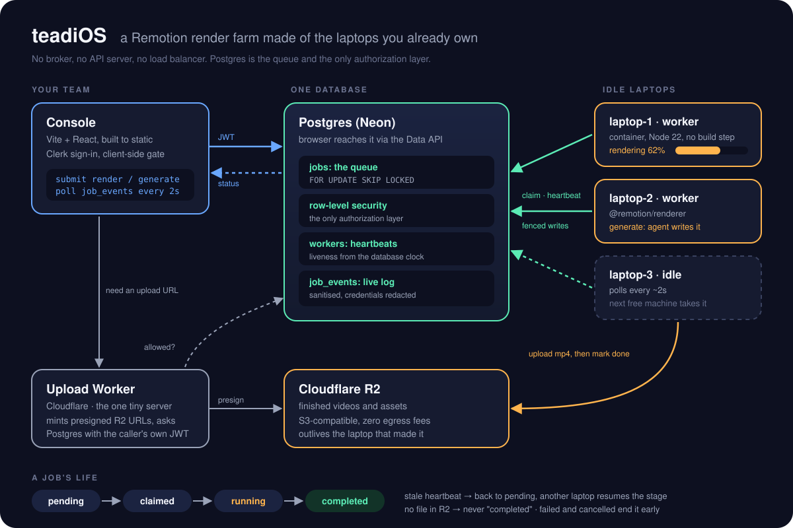
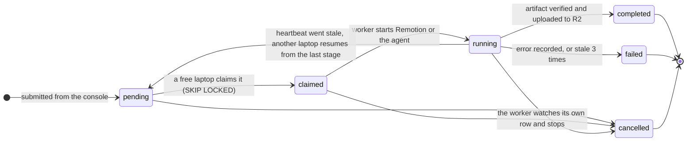

# teadiOS

An open-source [Remotion](https://remotion.dev) render farm made of the laptops
your team already owns.

A Remotion render pins one machine for an hour while everyone else's laptop sits
at three percent. teadiOS puts the queue in Postgres, a container on every
laptop, and the finished file on your CDN. Anyone on the team submits from the
browser; the next free machine takes it.



Two kinds of job share one queue:

- **`render`** — build a composition the team already wrote, at given props.
- **`generate`** — hand a headless agent a script and let it author the
  composition, then render it.

[`system-design.md`](system-design.md) is the architecture and, more usefully,
the list of things that go wrong. [`DEPLOY.md`](DEPLOY.md) is how to stand it up.

## A job's life



Two workers can never hold the same job, and every write a worker makes carries
"and I still own this job", so a laptop that wakes up late cannot overwrite the
one that took over.

## The stack, and why each piece

| Layer | Choice | Why this one |
|---|---|---|
| Console | Vite + React + TypeScript, built to **static** | The architecture forbids a server data tier. Next.js's whole value is the server, which here is a liability: a place to put a database credential and a second authorization model to keep in sync. |
| Auth | `@clerk/clerk-react` | Clerk sets its session cookie on its own hostname, so a server could not read it anyway. A static build settles the question: the auth gate is client-side. |
| Data | `@supabase/postgrest-js` → Neon Data API | The browser talks straight to Postgres. Neon's Data API is PostgREST; postgrest-js speaks PostgREST. A custom `fetch` attaches the Clerk token. |
| Polling | `@tanstack/react-query` | Workers poll, so the console polls. Structural sharing means a 2-second poll does not reflow the list or steal focus. |
| Styling | One CSS file, custom properties | No Tailwind, no PostCSS config, no build plugin. There are about six screens. |
| Worker | Node 22+ and TypeScript, **run directly** | Node strips types natively now, so there is no bundler and no build step in the container. |
| DB driver | `pg` | A long-lived process holding real transactions. The HTTP driver is for serverless. |
| Rendering | `@remotion/bundler`, `@remotion/renderer` | |
| Artifacts | `aws4fetch` → Cloudflare R2 | R2 is S3-compatible and charges nothing for egress, which matters when the output is video. `aws4fetch` is a few KB against the AWS SDK's tens of MB, and it is the same signer the upload Worker needs — one signing library in the repo, not two. |
| Uploads | One Cloudflare Worker | R2 has no row-level security, so *something* must mint presigned URLs. It holds only the R2 key and delegates authorization back to Postgres using the caller's own JWT — so there is still exactly one authorization model. |
| Monorepo | npm workspaces | Already in npm. |

## Layout

```
db/       schema, row-level security, the claim queue, and the adversarial suite
web/      the console (static; index.html is the landing page today)
worker/   the container that runs on each laptop
upload/   the one small server: presigned R2 upload URLs
```

## Running the database tests

No Neon account needed — the schema loads on a bare Postgres so the policy suite
can run anywhere.

```bash
docker run -d --name teadio-pg -e POSTGRES_PASSWORD=x -p 55432:5432 postgres:18
PGPASSWORD=x psql -h localhost -p 55432 -U postgres -v ON_ERROR_STOP=1 -f db/schema.sql
PGPASSWORD=x psql -h localhost -p 55432 -U postgres -v ON_ERROR_STOP=1 -f db/test_rls.sql
```

It proves an outsider sees nothing, a member cannot escalate, a worker cannot
read identities, two workers never take the same job, and a worker that lost its
claim cannot overwrite the one that has it. Change a policy, re-run it, and also
break one invariant on purpose to confirm the suite still goes red — a green
suite proves nothing on its own.

## Running the worker tests

Same throwaway Postgres. The worker connects as `teadio_w1`, the same narrow
role it uses in production, so the column grants and policies are exercised
rather than discovered later.

```bash
npm install
npm test
```

Fifteen tests, all against a fake agent (`worker/test/fake-agent.mjs`) rather
than real rendering: claiming, heartbeats, stale reclaim, fenced writes,
cancellation, shutdown mid-render, refusing an agent that reports success
without producing a video, failing a run that could not upload, and keeping
credentials out of the browser-readable event feed.

The same warning applies. These were checked by breaking eight invariants one at
a time — removing artifact verification, marking a job complete before the
upload, disabling the ownership watcher, letting the sanitiser pass everything
through — and confirming each turns the suite red.

## Licence

teadiOS is MIT. **Remotion itself is not** — it is free for individuals and small
companies and requires a paid company licence above that, with restrictions on
offering it as a service. Check where your team lands before pointing it at one.
